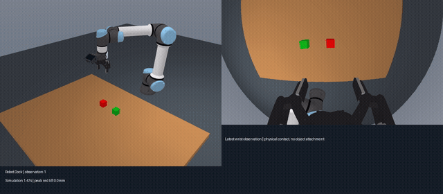

# Robot Dock

[简体中文](README.md) | **English**

**A harness for remote embodied models and robot execution.**

Robot Dock connects embodied model services to simulation and real robots through
an explicit observe–infer–execute–feedback loop. The runtime owns execution
accounting, cancellation, run budgets and evidence. Model adapters own their wire
protocol and sessions; robot backends own device control.

Status: initial implementation, public interfaces are experimental. The shipped
integrations include RoboAPI, an OpenAI-compatible vision Cartesian planner, and
MuJoCo UR5e/Robotiq 2F-85. Real hardware and asynchronous inference remain extension points.

## Stacking demo

[](docs/media/stacking-two-stage.mp4)

[Watch the separately preserved full MP4](docs/media/stacking-two-stage.mp4). This real
RoboAPI episode uses two instructions: lift and hold, followed by operator-initiated
placement. Two 44 mm cubes stack and remain stable for over one second after release
and withdrawal. The GIF runs at 3x; the original dual-view recording is encoded from
control frames and does not represent wall-clock duration. This example establishes
neither autonomous single-instruction stacking nor a measured success rate.

## Quick start

Python 3.12+, Git and [uv](https://docs.astral.sh/uv/) are required. Windows and
Linux are intended targets. Offline checks run in the CI matrix; hardware and model
performance must be evaluated separately.

```bash
git clone git@github.com:liberow/Robot-Dock.git
cd Robot-Dock
uv sync --extra mujoco
uv run --group assets python scripts/fetch_assets.py
```

To run the real remote model, create your own RoboAPI key, then:

```bash
uv run robot-dock run configs/pokebot.mujoco.lift.json --viewer
```

Actions come from real service responses, with no fallback to predefined trajectories.
The lift example has a budget of 40 chunks or 180 seconds. It requires the red
cube to be lifted at least 5 cm and held nearly still by both pads, without support
from the green cube, for one second. One real remote-model run succeeded in 17
chunks; this is a verified example, not a measured success rate.
The harder stacking example remains `configs/pokebot.mujoco.json` (100 chunks or
600 seconds). Both tasks terminate early on physical task success.
Single-instruction end-to-end stacking has not yet been verified; API connectivity and
offline test success do not establish model task success.

### Reproduce stacking in two stages

Run the lift configuration above with `--viewer`, without `--once`. After the red
cube is held and the first task ends, enter `/stack` at the terminal. It starts a
new remote-model session in the same physical world with the instruction
`Place the red cube on top of the green cube.` and the original stack evaluator.
The operator explicitly starts this task; it is not automatically chained.

One real run used 8 chunks to lift, then 22 chunks to place. The original 44 mm
cubes touched with about 8.5 mm horizontal centre offset; after release and
withdrawal the stack remained stable for over one second. This verifies a
two-instruction reproduction, not single-instruction end-to-end stacking or a
success rate. All actions came from the remote model and physics kept running.

The CLI prompts for the key with hidden input. It also accepts
`PLATFORM_API_KEY` from the environment. Credentials are never part of configs or
run records. Model calls send simulation observations to the vendor and use your
account quota. Omit `--viewer` for offscreen recording. On headless Linux, set
`MUJOCO_GL=egl` if your driver supports EGL.

The quick-start task lifts and holds the red cube. The stacking configuration
places the red cube **on top of** the green cube. With `--viewer`,
the first task starts immediately. When it ends, the same world stays open and
physics keeps running while the terminal accepts the next instruction. Enter repeats the default
instruction; `/quit`, Ctrl+C at the prompt, or closing the window ends the session.
Enter `/stack` to start the placement task with its stack evaluator, preferably
after grasping the red cube.
Ctrl+C during a task interrupts that task and returns to the prompt. Instructions
apply to the next task, each with a new provider session; they do not reset the world.
Every task executes at least one model chunk before checking success.
Custom instructions use the configured chunk/time budget and have no automatic
success evaluator.
Use `--viewer --once` for one task followed by automatic window cleanup.

For a headless server, use `--web-viewer --web-port 18765` instead of `--viewer`.
The loopback browser service shows external/wrist frames and run status; an SSH
tunnel makes it available locally. It stays open after the task for inspection.
See [headless visualization](docs/headless-viewer.md) for exact commands.

### Cartesian planning with OpenAI-compatible models

Set `OPENAI_API_KEY`, `OPENAI_API_BASE` and `OPENAI_API_MODEL` in `.env`, then run:

```bash
uv run robot-dock run configs/openai.mujoco.lift.json --viewer
# For single-instruction stacking, use configs/openai.mujoco.json
```

The `openai_cartesian` adapter uses the OpenAI-compatible Chat Completions protocol;
configuration selects the provider and model. Models must accept images and support
JSON output. DeepSeek Flash is one option; revalidate compatibility and task performance
after switching models. The model receives wrist RGB, measured flange and pinch-center
poses, gripper opening, and static camera calibration. It returns up to six seconds of Cartesian
waypoints, sampled by a generic interpolator at 30 Hz and executed through the same
backend IK and physics. There are no predefined task trajectories or failure fallbacks.
The model can first project selected pixels onto an explicitly chosen horizontal plane,
then choose its own waypoints. This tool supplies neither object ground truth nor measured
depth. The example's `robot.support_plane_z_m: 0.0` declares the current tabletop calibration;
remeasure it or omit it on another setup. Each turn includes the previous action-input RGB
and current action-result RGB to help the model assess grasping outcomes.
Both policies share the scene, robot, instructions and success criteria; `/stack` also
works for two-stage comparisons. Their chunks span different durations, so report
wall-clock time, dispatched steps and physical success rates rather than chunk counts
alone. Connectivity and offline tests do not establish task success. See the
[adapter documentation](docs/adapters.md#openai-compatible-cartesian-planner).

### Credentials and configuration

For a persistent local configuration, copy `.env.example` to `.env` and fill
`ROBOT_DOCK_POKEBOT_API_KEY`. The CLI reads `.env` in the current directory;
`--env-file PATH` selects another file explicitly. Process variables take
precedence, values are literal (no shell interpolation), and library imports do
not load environment files. Endpoint/model overrides use
`ROBOT_DOCK_POKEBOT_BASE_URL` and `ROBOT_DOCK_POKEBOT_MODEL`.

Every run gets its own directory under `runs/`: `dataset.h5`, `events.jsonl`,
`summary.json`, the vendor responses/session receipts and `robot/video.mp4`.
Existing run directories are not overwritten. Ctrl+C requests interruption;
adapters report actual dispatched steps. Ambiguous execution is never retried.
Interactive sessions keep one continuous `robot/video.mp4`; each task stores its
own events, summary, observations and policy responses in `tasks/0001/`, etc.
Console diagnostics use Python `logging` on stderr, with timestamps, levels and
module names. INFO shows task and chunk progress; `--log-level DEBUG` adds inference
frame diagnostics. Libraries do not configure logging handlers. Structured records
remain in `events.jsonl` and `summary.json`; console summaries no longer dump JSON.

Each task writes one HDF5 episode for training, analysis and command replay. It
contains both policy decision observations and synchronized control-step samples:
RGB, measured state, commanded action and actual capture/dispatch timestamps.
Images are stored inside HDF5 instead of separate PNG files. Task samples finalize
at task end; the session MP4 finalizes when the viewer/session closes normally.
See [dataset format and usage](docs/datasets.md). This is the native Robot Dock
format, not a claim of LeRobot/RLDS compatibility.

## Python API

```python
from pathlib import Path
from robot_dock import RunConfig, run

# policy and backend implement the small public protocols.
outcome = run(
    policy=policy,
    backend=backend,
    config=RunConfig(Path("runs/my-run"), "Pick up the red cube."),
    binding=binding,
    evaluate=evaluate_task,
)
```

`evaluate_task` receives measured observations. Inference success, action dispatch
completion and physical task success are distinct. Without an evaluator,
`task_success` remains unknown. See the [architecture](docs/architecture.md) and
[adapter guide](docs/adapters.md).

## Reference experiment boundaries

- Full UR5e and 2F-85 meshes, numerical IK, joint servos and contact physics.
- Upstream Menagerie gripper linkage and pad friction, with the C4 parallel-locking
  kit required by RoboAPI. Visible camera, frame, brackets and fasteners follow the
  official Ace Pro 2 assembly. See [asset provenance and accuracy](assets/README.md).
  Camera optics and gripper timing now use the checksum-pinned roboapi-playground
  v1.0.0 reference rig. Its optical transform has a 27.57-degree tilt, distinct
  from the visible CAD mount's nominal 30 degrees. Full 640x360 RGB uses the
  authored F-theta polynomial. This is reference-rig calibration, not a physical
  calibration of this UR5e. Arm damping is computed from Home joint inertia;
  upstream stiffness and force limits are retained. New hardware profile:
  `roboapi_reference_rig_v4`; do not pool its results with earlier profiles.
- The model receives RGB and measured flange/opening state, not object ground truth.
  Simulator observations also record pad contacts, normal forces and object offsets
  for offline diagnosis; these ground-truth fields are excluded from model input.
- The fixed default cube positions are `[-0.13, -0.46, 0.022]` and
  `[0.02, -0.46, 0.022]` metres. Both cubes are fully visible at Home with the
  standard mount and nominal optics; positions do not adapt to model behavior.
  This `tabletop_home_visible_v2` scene differs from older runs at Y = -0.65 m,
  where the corrected camera mount leaves cubes partly outside the frame.
  Do not pool their success rates as the same evaluation setting.
- Physics keeps running during inference and terminal input, paced to wall time.
  Dispatch targets 30 Hz without skipping commands; actual rate and physics lag are
  recorded. This is not a hard real-time guarantee.
  Physics and command pacing use a high-resolution clock to avoid coarse timer
  ticks on Windows Python 3.12 affecting the control period.
  The RoboAPI configuration sets `robot.inter_chunk_pause_s` to 0.5, matching the
  [official runtime](https://developers.pokebot.com/docs/roboapi/latest/console):
  wait after each completed chunk before capturing the next observation. Physics
  continues during this wait; the backend default is zero for other configurations.
- Cartesian policy targets are not clipped or rejected by an arbitrary scene
  bounding box. The backend's IK/controller and physical contacts determine execution.
- The default evaluator checks cube alignment, height, mutual contact, low object
  speed, release and gripper withdrawal, sustained for one second of physics time.
  It does not certify long-term stability
  or collision-free operation. The legacy `pick_place` evaluator remains available.
- Gripper commands retain raw provider values; the MJCF actuator's physical input
  range limits actuation. Saturation counts and controller errors are recorded.
- Observation-age rejection is opt-in through `RunConfig.max_observation_age_s`;
  there is no universal two-second cutoff. Recording uses ordered background writes,
  drained at task end, and is not a crash-durable journal.

## Development

```bash
uv sync --extra mujoco
uv run poe style       # apply formatting fixes
uv run poe lint        # repository validation + full-source mypy
uv run poe test        # offline tests + JUnit
uv run poe coverage    # branch coverage + XML report
uv run poe ci          # non-mutating CI checks
```

Optional local hooks: `uv run pre-commit install`. Hooks are configured but are
not installed automatically. Ruff, pytest and mypy have one configuration source
in `pyproject.toml`, including shared local/CI entry points and coverage settings.
Reports and temporary test files are generated under `artifacts/test/` and ignored
by Git. Remove generated reports, temporary files and tool caches after verification;
keep maintained tests and recorded inference datasets.

Default tests use fake devices and a stubbed vendor transport, no key or paid
calls. Real MuJoCo and live API validation are explicit commands above.

Code: MIT. Downloaded robot assets retain their upstream licenses.
See [CONTRIBUTING](CONTRIBUTING.md).
