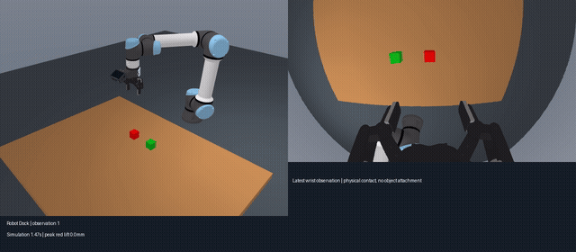

# Robot Dock

**简体中文** | [English](README.en.md)

**连接远程具身模型与机器人执行的 Harness。**

Robot Dock 通过明确的“观测—推理—执行—反馈”循环，将具身模型服务连接到仿真与真机。
运行时负责执行计数、中断、运行预算和记录；模型适配器负责服务协议与会话；机器人后端负责设备控制。

项目处于初期实现阶段，公共接口仍在调整。目前提供 RoboAPI、OpenAI 兼容视觉模型的笛卡尔规划适配器，
以及 MuJoCo UR5e／Robotiq 2F-85 后端。真实硬件和异步推理是扩展方向，尚未声明支持。

## 堆叠演示

[](docs/media/stacking-two-stage.mp4)

[观看独立保存的完整 MP4](docs/media/stacking-two-stage.mp4)。这是一次真实 RoboAPI 远程推理的两步指令演示：
先抓起并保持，再由操作员发起放置；两个 44 mm 方块完成堆叠，松爪撤离后稳定超过一秒。
GIF 为 3 倍速预览；原始录像包含双视角，按控制帧编码，不代表实际墙钟耗时。
该案例不代表单指令自主堆叠或统计成功率。

## 快速开始

需要 Python 3.12+、Git 和 [uv](https://docs.astral.sh/uv/)。目标平台为 Windows 和 Linux。
CI 在平台矩阵中运行离线检查；硬件适配和模型表现需要单独验证。

```bash
git clone git@github.com:liberow/Robot-Dock.git
cd Robot-Dock
uv sync --extra mujoco
uv run --group assets python scripts/fetch_assets.py
```

使用自己的 RoboAPI 密钥运行真实远程模型：

```bash
uv run robot-dock run configs/pokebot.mujoco.lift.json --viewer
```

模型动作来自真实服务响应，不会回退为预设轨迹。
抓取抬升示例预算为 40 段动作、180 秒。成功条件是红块抬升至少 5 cm、由两侧指垫夹持，
不受绿块支撑，并近乎静止地保持一秒。一次真实远程模型运行在 17 段动作后成功；
这是已验证示例，尚不是成功率统计。
更难的堆叠示例仍使用 `configs/pokebot.mujoco.json`，预算为 100 段动作、600 秒。
两种任务都在物理成功条件满足后提前结束。
单条指令端到端完成堆叠仍未验证成功；接口连通和离线测试通过不代表模型完成任务。

### 分步复现堆叠

使用上面的抓取配置并保持 `--viewer`（不加 `--once`）。红块被抓稳、第一项任务结束后，
在终端输入 `/stack`。它在同一物理世界中启动新的远程模型会话，指令为
`Place the red cube on top of the green cube.`，并启用原始堆叠成功判定。
这一步由操作者显式启动，不会自动接在抓取之后执行。

一次实际运行中，抓取用了 8 段动作，随后放置用了 22 段动作；两个原始 44 mm 方块形成接触，
水平中心偏差约 8.5 mm，夹爪松开撤离后稳定超过一秒。此结果是两条指令的分步复现，
不代表单条指令端到端堆叠或统计成功率。全过程使用远程模型动作，物理持续运行。

命令行会以隐藏输入的方式询问密钥，也支持环境变量 `PLATFORM_API_KEY`。
凭据不会写入配置或运行记录。模型调用会向服务方发送仿真观测，并消耗账号额度。
省略 `--viewer` 可离屏运行并保存记录；无头 Linux 服务器在驱动支持 EGL 时可设置 `MUJOCO_GL=egl`。

快速开始任务是抓起红块并保持在空中；堆叠配置的任务是将红块放到绿块**上面**、松爪并撤离。
使用 `--viewer` 时，第一个任务立即执行；结束后窗口保持打开，物理仿真继续运行，终端接受下一条指令：

- 按 Enter：再次执行默认指令。
- 输入 `/stack`：启动红块放到绿块上的任务，启用堆叠成功判定；建议在抓稳红块后使用。
- 输入自定义指令：下一次任务使用该指令，并创建新的模型服务会话，不重置世界。
- 任务执行中按 Ctrl+C：中断当前任务，返回输入提示。
- 输入 `/quit`、在输入提示处按 Ctrl+C，或关闭窗口：结束会话。

每次任务至少执行一段模型动作后才检查成功。自定义指令使用配置中的动作段数与时间预算，
没有自动成功判定。
使用 `--viewer --once` 可执行一个任务后自动关闭窗口。

在无头服务器上，用 `--web-viewer --web-port 18765` 替代 `--viewer`。
浏览器服务仅监听本机回环地址，展示外部视角、腕部相机和运行状态；可通过 SSH 隧道在本地访问。
任务结束后服务继续保留，便于查看。具体命令见[无头服务器可视化](docs/headless-viewer.md)。

### OpenAI 兼容模型的笛卡尔规划对照

在 `.env` 中配置 `OPENAI_API_KEY`、`OPENAI_API_BASE` 和 `OPENAI_API_MODEL` 后运行：

```bash
uv run robot-dock run configs/openai.mujoco.lift.json --viewer
# 单指令堆叠使用 configs/openai.mujoco.json
```

`openai_cartesian` 表示 OpenAI 兼容的 Chat Completions 协议；服务商与模型由配置决定。
模型必须支持图片输入和 JSON 输出。DeepSeek Flash 是一种选择；切换模型后需重新验证兼容性和任务表现。
它根据腕部 RGB、实测法兰与夹持中心位姿、夹爪开度及静态相机标定，生成最多六秒的笛卡尔路点，
通用插值器按 30 Hz 采样，再由同一后端进行逆运动学与物理执行。没有预置任务轨迹或失败回退。
模型可先调用图像点到指定水平面的几何投影工具，再自主生成路点；该工具不提供物体真值或深度测量。
配置中的 `robot.support_plane_z_m: 0.0` 是当前场景的桌面标定高度；更换环境时应重新标定或省略。
每轮同时提供上次动作前与当前动作后的 RGB，以辅助模型判断抓取效果。
两种策略共用场景、机器人、任务指令和成功判据；`/stack` 同样可用于两步对照。
路点规划与 RoboAPI 动作段的时长不同，比较时需报告墙钟耗时、实际下发步数及物理成功率，不能只比较段数。
接口连通与离线测试通过均不代表任务成功。详见[适配器说明](docs/adapters.md#openai-compatible-cartesian-planner)。

### 密钥与配置

将 `.env.example` 复制为 `.env`，填写 `ROBOT_DOCK_POKEBOT_API_KEY`。
CLI 默认读取当前目录的 `.env`，也可通过 `--env-file PATH` 指定文件。
进程环境变量优先；配置值按字面读取，不进行 shell 插值；导入 Python 库不会自动加载环境文件。
服务地址与模型可通过 `ROBOT_DOCK_POKEBOT_BASE_URL`、`ROBOT_DOCK_POKEBOT_MODEL` 指定。

### 日志与数据集

每次运行在 `runs/` 下创建独立目录，包含 `dataset.h5`、`events.jsonl`、`summary.json`、
服务响应与会话执行回执，以及 `robot/video.mp4`。已有运行目录不会被覆盖。
Ctrl+C 请求中断，适配器报告实际下发的步数；执行结果不明确时不会自动重试。
交互会话共用一段连续的 `robot/video.mp4`，每个任务的事件、摘要、观测与模型响应分别存入
`tasks/0001/` 等目录。

控制台使用 Python 标准 `logging`，输出到 stderr，包含时间、级别和模块名。
INFO 显示任务及动作段进度，`--log-level DEBUG` 增加推理帧诊断。
库本身不配置日志处理器。结构化记录保留在 `events.jsonl` 和 `summary.json`，控制台摘要不再直接打印 JSON。

每个任务保存一份 HDF5 数据集，用于训练、分析与指令回放，包含模型决策时的观测和控制步采样：
RGB、实测状态、下发动作及实际采集／下发时间戳。图像存放在 HDF5 内，不逐帧生成 PNG。
任务采样在任务结束时写完；会话 MP4 在窗口或会话正常关闭时完成封装。
详见[数据集格式与用法](docs/datasets.md)。这是 Robot Dock 原生格式，尚未声明兼容 LeRobot／RLDS。

## Python API

```python
from pathlib import Path
from robot_dock import RunConfig, run

# policy 和 backend 分别实现对应的公共协议。
outcome = run(
    policy=policy,
    backend=backend,
    config=RunConfig(Path("runs/my-run"), "Pick up the red cube."),
    binding=binding,
    evaluate=evaluate_task,
)
```

`evaluate_task` 接收实测观测。推理调用成功、动作下发完成、物理任务成功是不同的结果。
未提供评估器时，`task_success` 保持未知。
详见[架构说明](docs/architecture.md)与[适配器开发指南](docs/adapters.md)。

## 参考实验的能力与限制

- 使用完整 UR5e、2F-85 网格，以及数值逆运动学、关节伺服和接触物理。
- 保留 Menagerie 的夹爪连杆与指垫摩擦，加入 RoboAPI 要求的 C4 平行锁定套件。
  相机、保护框、支架与紧固件参考官方 Ace Pro 2 装配；见[资源来源与精度说明](assets/README.md)。
  相机光学与夹爪时序使用经哈希校验的 roboapi-playground v1.0.0 参考 rig 参数。
  光学外参倾角约为 27.57°，与可见 CAD 安装的名义 30° 区分；完整 640×360 RGB
  使用资产中的 F-theta 多项式。这是参考 rig 标定，并非当前 UR5e 的真机标定。
  机械臂阻尼根据 Home 关节惯量计算，保留上游刚度与力限制。新硬件标识为
  `roboapi_reference_rig_v4`，评估结果应与旧版本分开统计。
- 模型只接收 RGB 和实测法兰／夹爪开合状态，不接收物体真值。
  仿真观测另存指垫接触、法向力和物体相对夹爪位置，用于离线诊断；这些真值不会发送给模型。
- 两个方块的固定初始位置为 `[-0.13, -0.46, 0.022]`、`[0.02, -0.46, 0.022]` 米。
  在标准安装与近似光学参数下，Home 姿态可完整看到两个方块，位置不会随模型行为调整。
  当前场景标识为 `tabletop_home_visible_v2`；旧运行的 Y = -0.65 米，在修正相机安装后会出现方块裁切。
  两种场景的成功率不能按同一评测设置合并。
- 推理和终端输入期间物理仿真持续运行，按实际时间推进。
  动作下发目标为 30 Hz，不跳过指令，记录实际频率与物理时间落后量，不保证硬实时。
  物理推进与动作调度使用高精度时钟，避免 Windows Python 3.12 的粗粒度计时影响控制周期。
  RoboAPI 配置中的 `robot.inter_chunk_pause_s` 为 0.5 秒，与[官方运行时](https://developers.pokebot.com/docs/roboapi/latest/console)一致：
  一段动作完成后等待，再采集下一次观测。等待期间物理仿真继续；其他配置的后端默认值为零。
- 不使用任意场景包围盒裁剪或拒绝模型的笛卡尔目标；执行由后端逆运动学、控制器和物理接触决定。
- 默认评估器检查方块对齐、高度、相互接触、低速、松爪与撤离，并要求保持一秒物理时间。
  它不证明长期稳定性或全过程无碰撞；仍保留旧的 `pick_place` 评估器。
- 保留模型原始夹爪指令，实际驱动受 MJCF 执行器物理输入范围限制；记录饱和次数和控制误差。
- 观测过期拒绝需通过 `RunConfig.max_observation_age_s` 显式启用，没有通用的两秒限制。
  记录通过后台顺序写入，在任务结束时等待完成，不保证进程崩溃后的完整恢复。

## 开发

```bash
uv sync --extra mujoco
uv run poe style       # 自动修正格式
uv run poe lint        # 仓库检查与全部源码的 mypy 检查
uv run poe test        # 离线测试与 JUnit 报告
uv run poe coverage    # 分支覆盖率与 XML 报告
uv run poe ci          # 与 CI 相同的非修改性检查
```

本地提交钩子可通过 `uv run pre-commit install` 安装，不会自动安装。
Ruff、pytest、mypy 的配置统一放在 `pyproject.toml`，包括本地／CI 任务入口及覆盖率设置。
报告和临时测试数据生成在 `artifacts/test/`，不纳入 Git。
验证结束后应清理生成的报告、临时文件与工具缓存，保留长期测试代码及正式推理数据集。

默认测试使用模拟设备和服务传输桩，无需密钥，不调用付费接口。
真实 MuJoCo 和在线 API 验证使用上文的显式命令。

代码采用 MIT 许可证；下载的机器人资源保留各自的上游许可。见[贡献指南](CONTRIBUTING.md)。
